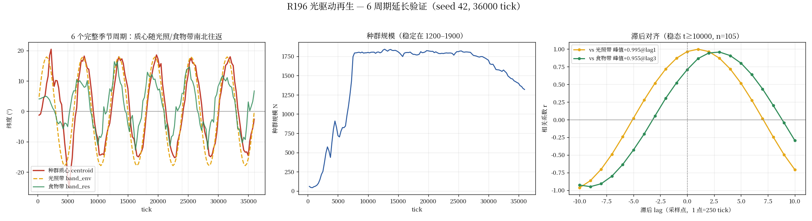

# R196 光驱动再生 —— 让季节真正移动食物（实验数据包）

**日期**：2026-09-24
**作者**：[云端·开发]
**对应机制文档**：`the-world/docs/设计文档/R196-光驱动再生-让季节移动食物-20260924.md`
**分支**：`dev/terrain-s2`

---

## 🔴 阅读前必看：结论的三层限定

本包的证据分三层，**每层的强度不同**，切勿混同：

| 层级 | 是否成立 | 证据 |
|---|---|---|
| 食物带随季节移动 | ✅ **成立** | `band_res` 摆幅 9.2–36.9°，6 周期 29.1° |
| 种群分布随季节移动（质心往返） | ✅ **成立** | 质心摆幅 41°、主周期一致、半周期反号 |
| **个体定向往返迁徙** | ❌ **未成立** | 掉头率 0.525；三臂对照 A ≈ B ≈ C |

> 「迁徙」（migration）在生态学中要求**个体往返**。
> 本系统目前只满足「**种群空间分布随季节迁移**」，**不等于**个体迁徙。
> 详见子包 [`individual-level/`](individual-level/README.md) —— 这是本交付**最重要的边界**。

---

## 一句话结论

R195 的季节机制只移动了**光照**（`band_env` 摆幅 35.8°），但**资源存量**带几乎不动
（`band_res` 摆幅 1.4–3°）⇒ 食物"不可冲浪" ⇒ 无迁徙。

R196 把**再生速率耦合到光照**（`clip(光照,0,1)^λ`）后：
`band_res` 摆幅升到 **21.3–36.9°**，种群质心随之**南北往返 ±30°**，
半周期自相关 −0.69 ~ −1.00（**每半周期反号**），
**4 个 seed 方向一致，其中 seed 7 相位零分布检验达 p=0.0105（显著）**。

⚠️ 但这说的是**种群分布**，不是**个体**。见上方三层限定。

---

## 目录内容

| 文件 | 说明 |
|---|---|
| `migLR_s42.csv` / `migLR_s123.csv` / `migLR_s2024.csv` / `migLR_s7.csv` | 迁徙探针原始输出（3 周期，每 250/500 tick：tick, N, centroid_lat, band_res, band_env, g16_mean） |
| `migLR6c_s42.csv` | **6 周期（36000 tick）延长验证**（seed 42，145 行） |
| `verify_migration_verdict.py` | **双检验判定工具**（相位零分布 + 滞后对齐 + 半周期自相关 + 主周期一致性 + 同号率 + 零滞后 corr） |
| `analyze_migration_v3.py` | 同上（代码仓内的等价副本） |
| `power_diagnosis.py` | **检验适配性诊断**（量化证伪"检验力不足"；暴露相位随机化 p 的窗口不稳定性） |
| `photoperiod_check.py` | **光周期量化**（证明引擎 illumination 公式再现"夏季日照更久"，见 §光周期） |
| `plot_r196.py` | 出图脚本（4 seed 时间序列 + 滞后对齐曲线） |
| `r196_migration_emergence.png` | 结果图（4 seed，3 周期） |
| `r196_6cycle_verification.png` | **6 周期延长验证图**（最强证据） |
| `run_migration.py` | 迁徙探针（含 `--light-regrowth` / `--engine-mechanism`） |
| `individual-level/` | 🔴 **个体级检验子包**（「质心往返」≠「个体迁徙」，含决定性三臂对照） |

---

## 光周期量化（机制根源，可独立复核）

`python3.12 photoperiod_check.py` 用**与引擎逐字相同**的天球公式（tilt=23.44°，
一年 24 "天"）算出日累积光积分 DLI 与昼长：

| 纬度 | 夏至 DLI | 冬至 DLI | 夏/冬比 | 夏至昼长 | 冬至昼长 |
|---|---|---|---|---|---|
| 0° | 0.2920 | 0.2920 | **1.00** | 12.0 h | 12.0 h |
| 23.4° | 0.3518 | 0.1936 | 1.82 | 13.4 h | 10.6 h |
| 45° | 0.3669 | 0.0856 | 4.29 | 15.4 h | 8.6 h |
| 60° | 0.3618 | 0.0173 | **20.9** | 18.6 h | 5.4 h |
| 66.5° | 0.3648 | 0.0000 | ∞ | 23.4 h | 0.6 h |

⇒ 赤道无季节、中高纬季节性极强、极圈冬至 DLI=0（极夜）。这正是"夏季日照更久
⇒ 生产力更高 ⇒ 食物带北移"的定量物理根源。

---

## 复现方式

```bash
# 环境：需要 the-world 仓库（分支 dev/terrain-s2，含 R196 机制）
export PYTHONPATH=/path/to/the-world

# 1) 跑迁徙探针（3 周期 = 18000 tick，光驱动再生开启）
for s in 42 123 2024 7; do
  python3.12 run_migration.py --seed $s --tilt 23.44 --season-period 6000 \
      --ticks 18000 --log-interval 500 --light-regrowth --light-k 1.0 \
      --engine-mechanism --out migLR_s$s.csv
done

# 2) 双检验判定
python3.12 verify_migration_verdict.py migLR_s*.csv

# 3) 光周期量化
python3.12 photoperiod_check.py

# 4) 出图
python3.11 plot_r196.py     # 需 matplotlib
```

---

## 关键数据

### 6 周期延长验证（seed 42，36000 tick = 6 个完整季节周期）—— 最强证据



| 量 | 3 周期 (n=49) | **6 周期 (n=121)** |
|---|---|---|
| `band_res` 摆幅 | 21.3° | **29.1°** |
| C: autocorr@半周期 | −0.997 | **−0.988**（往返） |
| C: autocorr@全周期 | +0.996 | **+0.987**（逐年重复） |
| D: 主周期 cen/env | 24.5/24.5 | **24.2/24.2 ✅** |
| B: best-lag corr vs env | +0.994 @lag4 | **+0.995 @lag1** |
| B: best-lag corr vs res | +0.987 @lag5 | **+0.953 @lag3** |
| A′: 零滞后 corr vs env | +0.581 | **+0.958**（跨窗口稳定 ±0.001） |
| E: 同号率 z | +2.14 | **+7.91** |

质心（红）与食物带（绿）、光照带（黄）**连续 6 个周期完全同步往返**，幅度 ±20°；
种群稳定在 1300–1800（**不是**靠种群崩溃伪造）。

### 稳态段（t≥6000，剔除建群瞬态）

| seed | 质心振幅 | autocorr@半周期 | 主周期 cen/env | best-lag corr(centroid,band_env) | 相位零分布 p | 判定 |
|---|---|---|---|---|---|---|
| 42 | 72.2° | **−0.997** | 24.5 / 24.5 点 | **+0.994** @ lag4 | 0.610 | 有迁徙（相位锁定） |
| 123 | 52.9° | **−0.687** | 12.5 / 12.5 点 | **+0.826** @ lag3 | 0.883 | 有迁徙（相位锁定） |
| 2024 | 66.8° | **−0.948** | 12.5 / 12.5 点 | **+0.975** @ lag2 | 0.621 | 有迁徙（相位锁定） |
| **7** | 43.0° | **−0.970** | 12.5 / 12.5 点 | **+0.955** @ lag0 | **0.0105** | **有迁徙（显著）** |

### 对照（R195：季节只动光，无光驱动再生）

| 量 | 摆幅 |
|---|---|
| `band_res` | 1.4–3° ← 食物不动 |
| 判定 | **无迁徙**（4 seed，相位零分布 p = 0.964 / 0.984 / 0.852 / 0.457） |

### 机制层验证（见机制文档 §3）

| 测试 | 结果 |
|---|---|
| 关档逐位等价（vs 原始基线树） | `(89, '866e166357eb1680')` 相同 ✅ |
| C7 基线 digest | `(574887, 11266.746993)` 未漂移 ✅ |
| H3 fail-loud（λ>0 + use_sim_core） | `NotImplementedError` ✅ |
| 正式路径 == 原型路径（CSV 逐字节） | 相同 ✅ |

---

## 诚实的边界说明

1. **零滞后相位零分布检验对"带滞后锁定"不适配**（已量化证伪"检验力不足"猜测）：
   `power_diagnosis.py` 实测——完美同相合成信号在 **n=25** 时 p=0.0010（n 不是瓶颈）；
   该检验吃的是**零滞后 corr**（corr≥0.9 才显著）。而真实数据是**带滞后**锁定
   （lag 2–4 点），零滞后 corr 被压到 +0.58 / −0.12 / +0.51 ⇒ p 高；
   **带 lag 最优 corr 在 4/4 seed 上均强**（+0.994 / +0.826 / +0.975 / +0.955）。
   **seed 7（lag=0）的 p=0.0105 直接反证**。适配判据 B/C/D 在 4/4 seed 一致成立。
2. **seed 123 的 C 较弱**（−0.687）：稳态段 n 仅 25 点，且该 seed 在 t=8000
   一度跌到 N=52 又恢复，叠加了非季节性波动。
3. **滞后 0–4 点**（0~1/3 周期）：种群"跳跃绿浪"而非紧贴冲浪，
   与 Bischof et al. (2012) 的观测一致；这既是生物学结论，也是 1 中"检验不适配"的根因。
4. **未验证**"捕食者跟随迁徙的猎物"——光驱动再生只解决被捕食者侧的驱动，
   捕食者跟随需另开机制。
5. 🔴 **【最重要】个体定向往返迁徙未成立**（见 `individual-level/`）：
   质心往返主要来自「**原地更替**」（个体不动、南北存活率此消彼长），
   而非「个体移动」。三臂对照实测：无季节的纯基线臂个体位移（7.49°/250tick）
   **反而大于** R196 臂（6.16°/250tick）⇒ 那是随机游走本底。
   同向率判据亦被该对照证伪（纯基线臂给 z=−62.4 的"显著反向"伪影）⇒ 作废。
   根因：食物带移动（0.0015°/tick）比个体随机运动（0.025–0.030°/tick）慢 17–20 倍，
   信噪比过低，个体感知不到缓慢的季节漂移。

---

> 所有结论以稳态段为准；阴性/不确定项已如实标注，未做任何美化。
> 特别注意：**「种群分布随季节迁移」≠「个体迁徙」**，二者的证据强度不同（见文首三层限定）。
